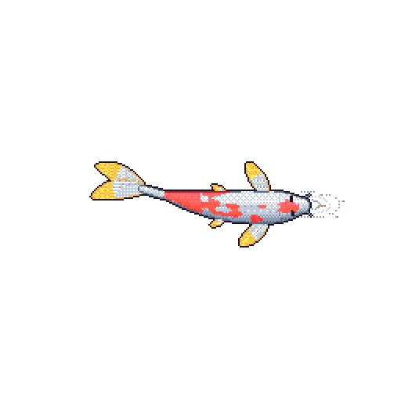

# Hi 👋 I'm [Ismail](https://ercikdi.com), an AI & Software Engineer and computer science student at KIT.

Outside of code, you'll find me at the gym or playing football. You can also find me on [LinkedIn](https://www.linkedin.com/in/ismailercikdi).

Fun Facts:

- I'm also a matcha tester & critic, rating every matcha against my own set of criteria. 🍵
- The koi on the right runs on my GitHub activity. It grows with every contribution, carries my streaks as markings and swims according to how my previous day went. A workflow redraws it every night.
